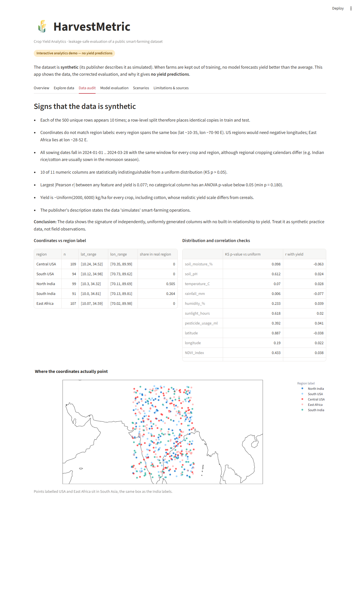
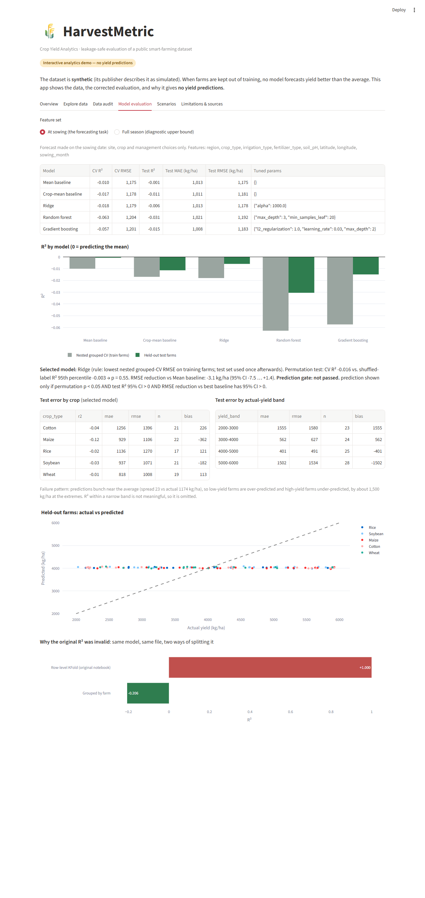
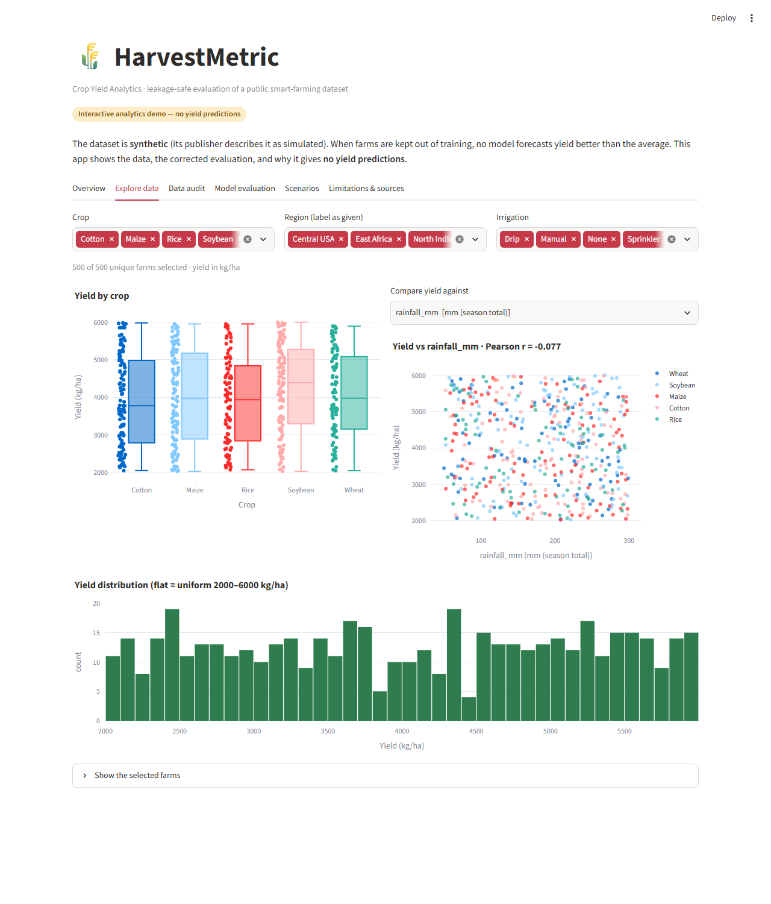
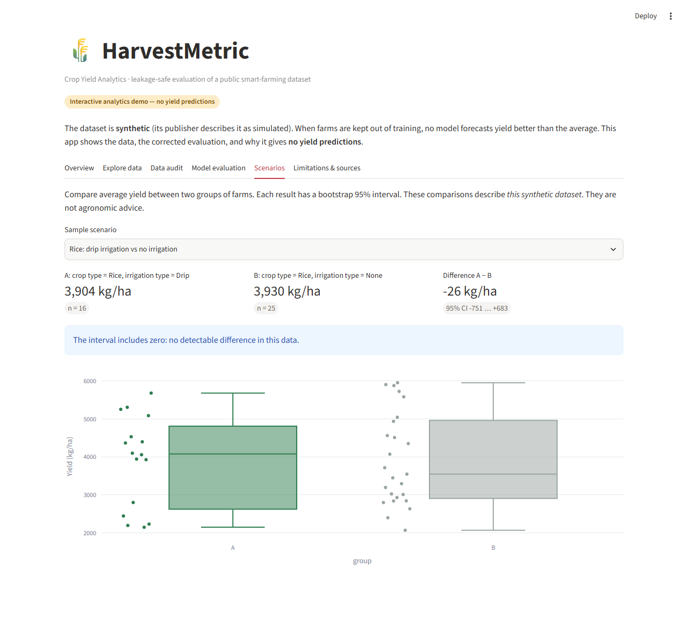

# HarvestMetric — Crop Yield Analytics

An audit and rebuild of a crop-yield modelling project. The original notebook reported
**R² = 1.00**. With leakage removed, **no model predicts yield better than the
average**. This repository shows why, using leakage-safe evaluation, and ships an
interactive Streamlit analytics demo instead of a misleading predictor.

> **Data notice.** The dataset is a public **synthetic** smart-farming dataset (Kaggle,
> Apache-2.0; its publisher describes it as simulated). Nothing here describes real farms.
> See [docs/DATA_PROVENANCE.md](docs/DATA_PROVENANCE.md).


## Key findings

| | R² | MAE (kg/ha) |
|---|---:|---:|
| Original notebook, row-level split on 10× duplicated rows | 1.000 (invalid) | ≈ 0 |
| Same model type, split grouped by farm | −0.21 | — |
| Mean baseline, held-out test farms | −0.001 | 1,013 |
| Selected model (Ridge, at-sowing features), held-out test farms | −0.006 (95% CI −0.060 … +0.001) | 1,013 |

- **Duplicates:** 5,000 rows contain only 500 distinct farms, each repeated 10 times. A
  row-level split puts identical copies in both train and test.
- **No signal:** permutation test p = 0.55. Even with in-season data (NDVI, rainfall,
  disease), no model beats the mean in cross-validation.
- **Synthetic data:** coordinates contradict region labels ("Central USA" at 70-90° E),
  numeric columns are independent uniform draws, and yield is ~Uniform(2000, 6000) for every crop.
- **Failure mode:** predictions collapse to ≈ 4,000 kg/ha, missing low- and high-yield
  farms by about 1,500 kg/ha.

Full details are in [docs/METHODOLOGY.md](docs/METHODOLOGY.md) and [docs/AUDIT.md](docs/AUDIT.md).

## What the project does

- **Defines the prediction point.** The forecast is made at sowing, so only site, crop
  and management choices are allowed as inputs. Post-harvest and in-season columns are
  blocked in code and by tests.
- **Evaluates without leakage.** Exact duplicates are removed. 100 farms are held out
  untouched. Hyperparameters are tuned with nested, farm-grouped CV on the other 400.
  Two baselines, Ridge, random forest and gradient boosting are compared.
- **Judges significance.** A label-permutation test and bootstrap intervals feed a
  *prediction gate*. The demo shows a prediction form only if the gate passes. Here it
  does not.
- **Interactive demo.** The Streamlit app has data exploration, the synthetic-data audit,
  the corrected evaluation, scenario comparisons with bootstrap CIs, and limitations.

## Quick start

Requires Python 3.11 or newer (tested on 3.14.7, Windows 11).

```bash
python -m venv .venv
```

```bash
# Windows: .venv\Scripts\activate    macOS/Linux: source .venv/bin/activate
pip install -r requirements-dev.txt
```

Get the data: download `Smart_Farming_Crop_Yield_2024.csv` from
[Kaggle](https://www.kaggle.com/datasets/atharvasoundankar/smart-farming-sensor-data-for-yield-prediction)
into `data/raw/`, or set `HARVESTMETRIC_DATA=/path/to/file.csv`.

| Task | Command |
|---|---|
| Data audit → `reports/data_audit.json` | `python -m harvestmetric.audit` |
| Train and evaluate → `reports/metrics.json`, `reports/tables/`, `artifacts/model.joblib` | `python -m harvestmetric.train` |
| Run tests (also run by GitHub Actions on every PR) | `python -m pytest` |
| Launch the app | `streamlit run streamlit_app.py` |
| Compare two copies of the dataset | `python -m harvestmetric.provenance A.csv B.csv` |

`requirements.txt` pins the runtime versions used here. `requirements-lock.txt` is the
full frozen environment. Training takes about 40 s on a laptop.

## Project layout

```
harvestmetric/
  config.py      paths, schema, allowed ranges and units
  data.py        loading, de-duplication, schema & date validation
  features.py    feature sets tied to the prediction point; shared preprocessor
  split.py       farm-grouped hold-out split + leakage assertions
  models.py      baselines, candidate models, tuning grids
  evaluate.py    metrics, bootstrap CIs, crop / yield-band breakdowns
  train.py       end-to-end protocol (python -m harvestmetric.train)
  inference.py   validated inference with the saved pipeline, gated
  audit.py       data-quality and synthetic-signal audit
  analytics.py   group comparisons used by the app
  provenance.py  record-level comparison of two dataset copies
streamlit_app.py Streamlit entry point
tests/           43 tests: leakage, validation, inference, app smoke tests
reports/         generated metrics and audit (committed)
docs/            audit, provenance, methodology, attribution, deployment, CV notes
```

## Screenshots

| Data audit | Model evaluation |
|---|---|
|  |  |

| Explore | Scenarios |
|---|---|
|  |  |

## Live demo

Not deployed yet. See [docs/DEPLOYMENT.md](docs/DEPLOYMENT.md).

## Limitations

- Synthetic data: findings describe this dataset, not agronomy.
- The documentation does not say when soil moisture and NDVI were measured. Both are
  treated as in-season.
- The test set is 100 farms, so intervals are wide.
- Pesticide usage is given per day, with no area basis.

## Credits and licence

- Code and documentation: MIT, © 2026 Abir Ahmmed ([LICENSE](LICENSE)).
- Dataset: *Smart Farming Sensor Data for Yield Prediction* by Atharva Soundankar, Kaggle,
  Apache-2.0. It is not redistributed in this repository ([NOTICE](NOTICE)).
- This repository is a rebuild of an earlier notebook developed with a friend. That
  notebook is not included. See [docs/ATTRIBUTION.md](docs/ATTRIBUTION.md).
