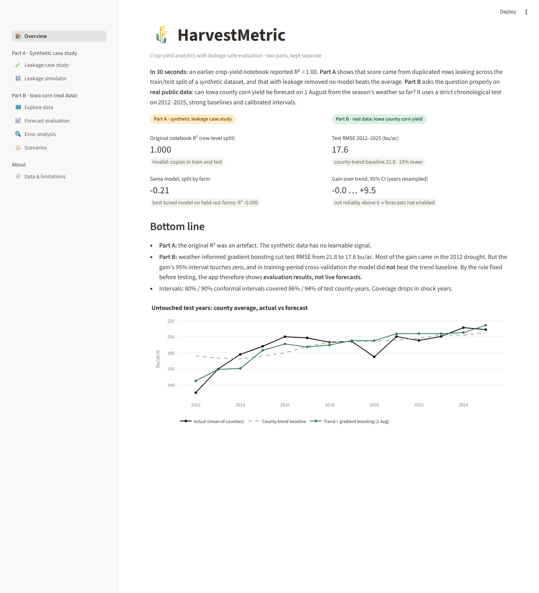
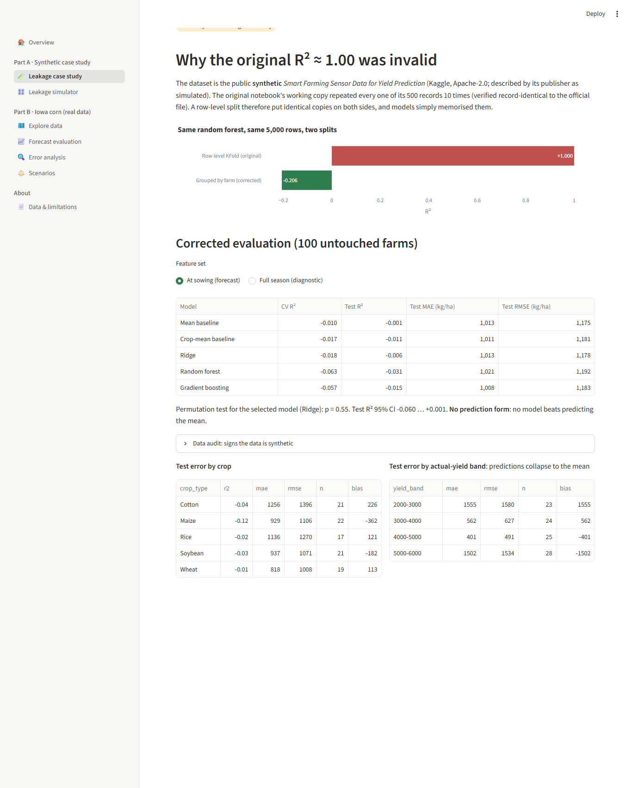
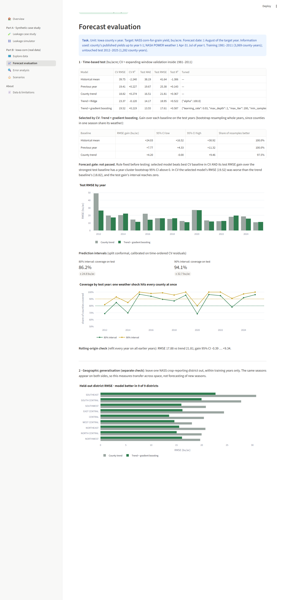
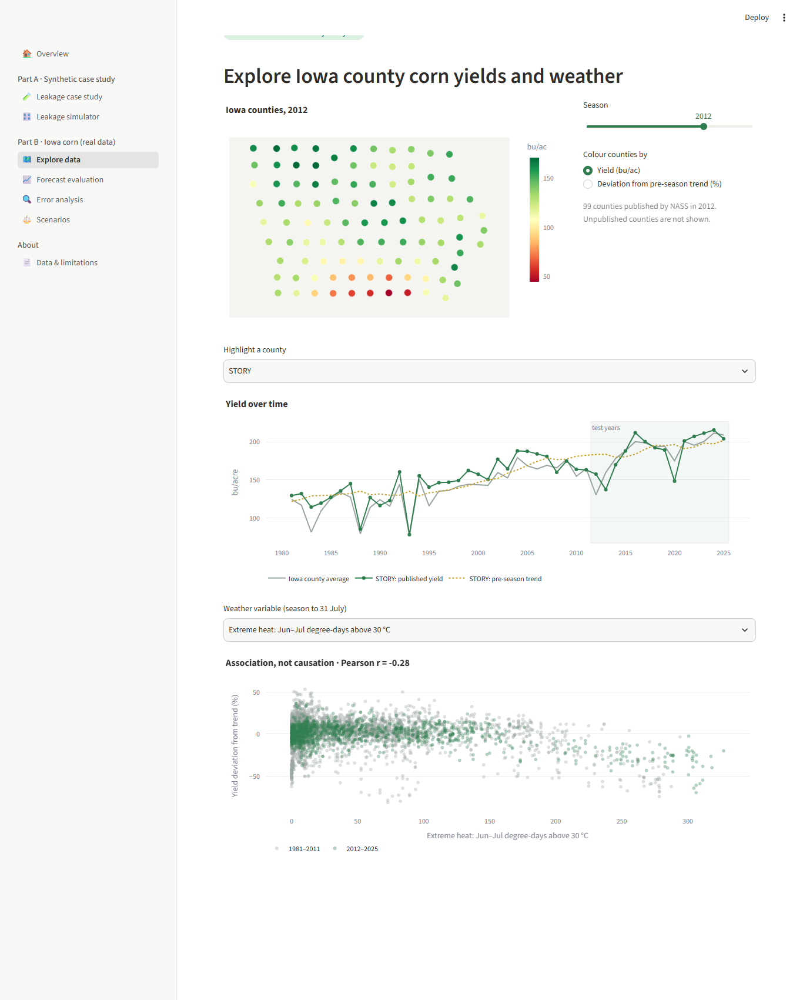
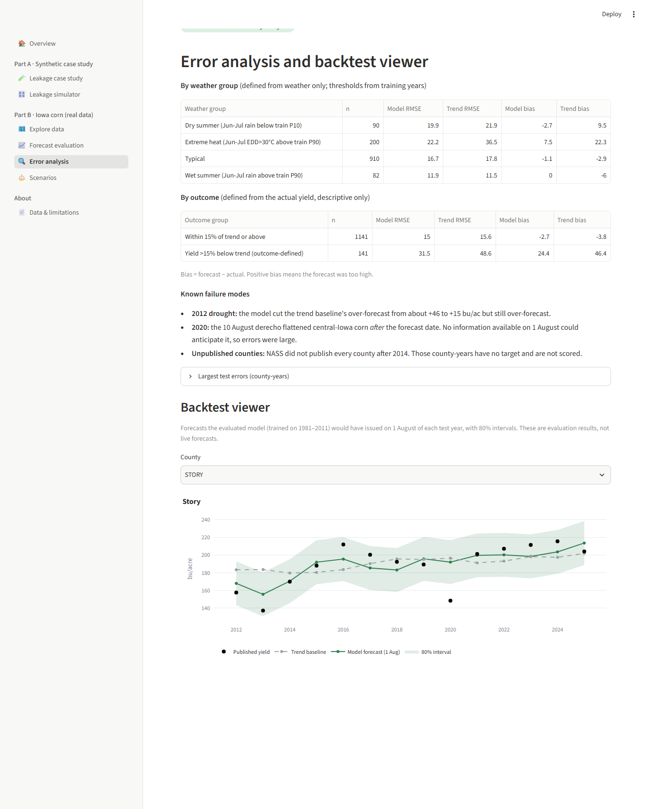

# HarvestMetric — Crop Yield Analytics

[](https://harvestmetric.streamlit.app)
[](https://github.com/devbyabir/harvestmetric/actions/workflows/tests.yml)

**Leakage-safe evaluation of crop-yield models, in two parts.**

- **Part A, a case study:** an internship notebook reported **R² ≈ 1.00**. That score came from duplicated
  rows leaking across a row-level split of a *synthetic* dataset. Split correctly, the same model scores
  **R² −0.21**, and no model beats the mean.
- **Part B, real data:** on public USDA and NASA data, a 1 August forecast of **Iowa county corn yield** was
  tested on untouched years 2012–2025. Weather-informed gradient boosting cut RMSE by **19%** against a
  county-trend baseline (17.6 vs 21.8 bu/acre). But a year-level bootstrap and training-period CV did not
  confirm the gain, so under the acceptance rule set in the code it is reported as **promising, not established**, and no
  live forecasts are published.

📄 **Technical report (4 pages):** [docs/report/HarvestMetric_technical_report.pdf](docs/report/HarvestMetric_technical_report.pdf)
· 🧭 **Live demo:** https://harvestmetric.streamlit.app (if the app has been idle it may take about a minute to wake up)



## Results at a glance

| | Model | Strongest baseline | Verdict |
|---|---|---|---|
| **A** Synthetic, 100 held-out farms | Ridge, test R² −0.006 (95% CI −0.060 … +0.001) | Mean, R² −0.001 | No skill (permutation p = 0.55) |
| **A** Same model, two splits | Row-level KFold R² **1.000** | Grouped by farm R² **−0.206** | Original score was leakage |
| **B** Iowa corn, test years 2012–2025 | Trend + gradient boosting, RMSE **17.6** bu/ac | County trend, RMSE 21.8 | Gain +4.2, 95% CI [−0.00, +9.46]: not established |
| **B** Geographic check (held-out districts, 1981–2011; tuned inside each fold) | RMSE 16.7 | County trend, RMSE 22.8 | Better in 9 of 9 districts |
| **B** 80% / 90% empirical CV-residual intervals (no coverage guarantee) | Coverage 86% / 94% | | Drops to 68–69% (at 80%) in 2012 and 2020 |

## What makes the evaluation trustworthy
- **A defined forecast moment.** Part A predicts at sowing; Part B on 1 August. Every feature is computed
  only from information available then, and tests enforce it.
- **No leakage across splits.**
  - Part A holds out whole farms.
  - Part B trains on 1981–2011 and tests once on 2012–2025.
  - Tuning uses expanding-window CV inside the training years.
  - Geography is checked separately, by holding out whole districts; the model and its hyperparameters
    are re-chosen inside each district fold, without the held-out district.
- **Strong baselines.** Historical mean, previous year and county trend.
- **Honest uncertainty.**
  - The bootstrap resamples whole *years*, since one season's weather hits every county.
  - Prediction intervals are empirical: ± a quantile of time-ordered CV residuals. Those residuals were
    also used for model selection, so the intervals carry **no** split-conformal coverage guarantee;
    coverage is checked on the test years instead.
- **A fixed acceptance rule.** Predictions are shown only if a model beats the baselines in CV *and* on
  the test years, with a confidence interval above zero. Neither part passed, and the app says so. The
  rule was written into the code before the test scores were computed, by the author's account; it is
  **not** an independently dated preregistration, and the commit history does not prove its timing.

## Data (all public; details in [docs/DATA_PROVENANCE.md](docs/DATA_PROVENANCE.md))
| Part | Source | Terms | In repo |
|---|---|---|---|
| A | *Smart Farming Sensor Data for Yield Prediction*, A. Soundankar (Kaggle). Synthetic; the original working copy was verified record-identical (×10 duplicated) | Apache-2.0 | No: aggregates only |
| B | USDA NASS Quick Stats: Iowa county corn-for-grain yield (bu/acre) | CC0 1.0 | Processed panel |
| B | NASA POWER daily point data v2.10.3 (T2M_MAX, T2M_MIN, PRECTOTCORR) | Citation required | Derived features |
| B | US Census Bureau 2024 Gazetteer county points | US Gov. work | Coordinates |

*This product uses NASS data but is not endorsed or certified by NASS. These data were obtained from the
NASA Langley Research Center (LaRC) POWER Project funded through the NASA Earth Science/Applied Science
Program.*

## Quick start
Requires Python ≥ 3.11 (developed on 3.14.7; CI runs 3.12 and 3.13).

```bash
python -m venv .venv
```

```bash
# Windows: .venv\Scripts\activate    macOS/Linux: source .venv/bin/activate
pip install -r requirements-dev.txt
```

```bash
streamlit run streamlit_app.py
```

The app needs nothing beyond the repository: Part B's processed panel and both parts' reports are committed.

### Reproduce everything
| Step | Command |
|---|---|
| Part A: download and verify the official file | `python -m harvestmetric.synthetic.acquire` |
| Part A: audit and evaluation | `python -m harvestmetric.synthetic.audit` then `python -m harvestmetric.synthetic.train` |
| Part B: download NASS, Census and NASA POWER | `python -m harvestmetric.real.acquire` |
| Part B: build the panel and evaluate | `python -m harvestmetric.real.prepare` then `python -m harvestmetric.real.train` |
| Lint, types, tests | `python -m ruff check .` · `python -m mypy` · `python -m pytest` |
| Technical report | `pip install -r requirements-report.txt` then `python docs/report/build_report.py` |

Versions, seeds, runtimes and data checksums: [docs/REPRODUCIBILITY.md](docs/REPRODUCIBILITY.md).

## Repository layout
```
harvestmetric/
  synthetic/   Part A: acquire, audit, data, features, split, models, train, inference, provenance, simulator
  real/        Part B: acquire, prepare, models, splits, intervals, train, forecast, analysis
  metrics.py   shared metrics and bootstrap   ui.py   app pages   app_data.py   committed-file access
streamlit_app.py, app_pages/   Streamlit entry point and pages
tests/         synthetic/, real/, test_app.py: leakage, splits, joins, units, inference, every app page
data/processed/  Part B panel + provenance manifest (raw downloads are git-ignored)
reports/       synthetic/ and real/ metrics and tables
docs/          provenance, Part A, Part B, model card, reproducibility, deployment, attribution, report
```

## Documentation
- [Part A: leakage case study](docs/PART_A_CASE_STUDY.md) · [Starting-state audit](docs/AUDIT.md)
- [Part B: methods and results](docs/PART_B_METHODS_RESULTS.md) · [Model card](docs/MODEL_CARD.md)
- [Data provenance and rights](docs/DATA_PROVENANCE.md) · [Attribution](docs/ATTRIBUTION.md)
- [Deployment](docs/DEPLOYMENT.md) · [Reproducibility](docs/REPRODUCIBILITY.md)

## Screenshots
| Leakage case study | Forecast evaluation |
|---|---|
|  |  |
| **Explore Iowa data** | **Error analysis & backtest** |
|  |  |

## Limitations
- Point weather per county from a coarse grid.
- NASS values may have been revised since they were first published.
- Counties are missing after 2014, not at random.
- Only 14 test years.
- One state and one crop.
- Part A is synthetic and says nothing about real crops.

## Credits and licence
- **Code and docs:** MIT, © 2026 Abir Ahmmed ([LICENSE](LICENSE)). Third-party data terms: [NOTICE](NOTICE).
- **Origins:** this is a rebuild of an exploratory notebook developed during an internship with a colleague.
  That notebook is not included ([docs/ATTRIBUTION.md](docs/ATTRIBUTION.md)).
