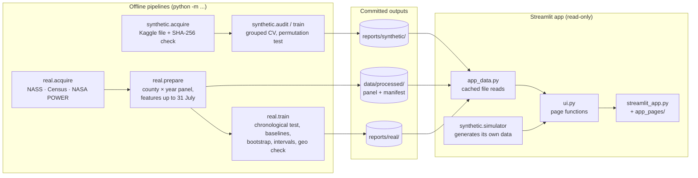

# Architecture

HarvestMetric has three layers: offline pipelines that download data and evaluate models, committed
outputs, and a read-only Streamlit app that only displays those outputs. The app never trains a Part B
model and never needs a file outside the repository.

## Packages

| Module | Responsibility |
|---|---|
| `harvestmetric/paths.py` | Project-relative paths. |
| `harvestmetric/metrics.py` | MAE, RMSE, R², bootstrap confidence intervals, grouped breakdowns. Shared by both parts. |
| `harvestmetric/synthetic/` | Part A: acquisition and checksum, audit, provenance check, grouped splits, models, training, inference, and the live leakage simulator. |
| `harvestmetric/real/config.py` | Every Part B constant in one place: forecast date, year ranges, CV blocks, source queries. |
| `harvestmetric/real/acquire.py` | Downloads raw sources and writes `manifest.json` with checksums, licences and retrieval times. |
| `harvestmetric/real/prepare.py` | Validates yields (units, withheld values, duplicates, plausible range) and builds features that use only information available on 1 August. |
| `harvestmetric/real/splits.py` | Chronological split, expanding-window folds and district folds, each with a leakage assertion. |
| `harvestmetric/real/models.py` | The three baselines and the trend-plus-deviation regressor, as scikit-learn estimators. |
| `harvestmetric/real/train.py` | The evaluation protocol end to end; writes `reports/real/`. |
| `harvestmetric/real/intervals.py` | Empirical interval quantile and coverage. |
| `harvestmetric/real/forecast.py` | Inference with input validation; refuses to forecast unless the acceptance gate passed. |
| `harvestmetric/app_data.py` | The only place the app reads files. Paths can be overridden by environment variables, which the tests use. |
| `harvestmetric/ui.py` | One function per app page; `app_pages/*.py` are one-line wrappers so Streamlit can route to them. |

## Design decisions
- **Preprocessing lives inside the estimators.** Training, evaluation and inference call the same object,
  so features cannot be computed differently at prediction time.
- **Leakage checks are code, not convention.** Splits raise `SplitLeakageError` if a boundary is crossed,
  and tests inject future weather and future yields to prove they cannot reach a feature.
- **The app is decoupled from training.** It reads committed outputs, so the demo starts in seconds and
  shows exactly the numbers in the report. CI re-runs `real.train` and fails if the metrics drift.
- **The forecast page is gated.** It is added to the navigation only if `metrics.json` says the model
  passed its acceptance rule, so an unvalidated model cannot be shown as a live forecast.

## Known trade-offs
- `ui.py` holds every page (about 500 lines). It is simple to test with Streamlit's `AppTest`, but a larger
  app would split it into one module per page.
- `real/train.py`'s `run()` is one long, linear protocol. That keeps the order of steps auditable; a
  library would break it into smaller functions.
- Part B weather is a single NASA POWER point per county, chosen for open access over spatial accuracy.
